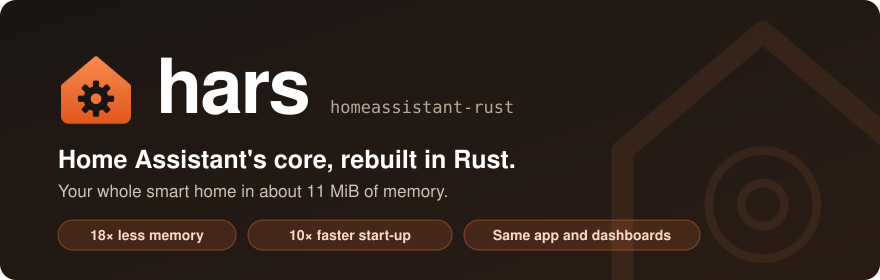
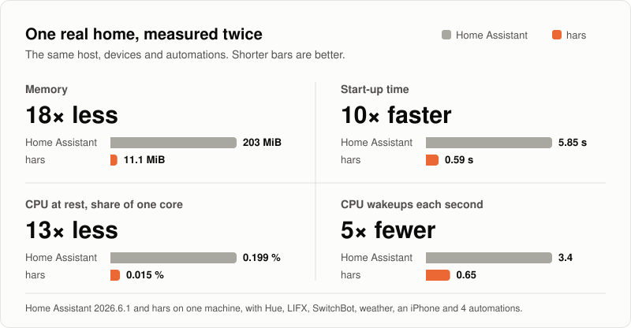

<h1 align="center">
  
</h1>

<p align="center">
  <a href="#get-started"><b>Get started</b></a> ·
  <a href="#what-works-today">What works today</a> ·
  <a href="#integrations">Integrations</a> ·
  <a href="docs/ROADMAP.md">Roadmap</a> ·
  <a href="docs/README.md">Documentation</a> ·
  <a href="CONTRIBUTING.md">Contributing</a>
</p>

<p align="center">
  <a href="https://github.com/adamt94/hars/actions/workflows/ci.yml"></a>
  <a href="LICENSE"></a>
  <a href="docs/ARCHITECTURE.md#home-assistant-compatibility"></a>
</p>

hars is a rebuild of [Home Assistant](https://www.home-assistant.io/)'s core
in Rust. It runs your smart home in about 11 MiB of memory, where Home
Assistant uses about 200 MiB. You keep the official Home Assistant web UI and
phone app. hars stores its data in Home Assistant's own file
formats, so you can bring an existing install with you.

> [!NOTE]
> hars is early software and supports a small set of integrations so far.
> Read [what works today](#what-works-today) before you switch.

## Why use hars

<p align="center">
  
</p>

| Measured on the same home | Home Assistant 2026.6.1 | hars | Difference |
|---|---|---|---|
| Memory | 203 MiB | 11.1 MiB | 18× less |
| Start-up time | 5.85 s | 0.59 s | 10× faster |
| CPU, share of one core | 0.199 % | 0.015 % | 13× less |
| CPU wakeups each second | 3.4 | 0.65 | 5× fewer |

Both ran in Docker on one machine with the same devices: Hue, LIFX, and
SwitchBot, a weather forecast, an iPhone, and 4 automations. Home Assistant
was measured on 15 November 2026 and the current hars on 20 November. The
CPU and wakeup figures favour Home Assistant: its figures cover five quiet
minutes, and the figures for hars are averages over 11.5 hours of normal use.
[The performance results](docs/perf/RESULTS.md#reference-install-again-2026-11-20)
describe how each number was measured.

- **It fits on small hardware.** A new install idles at 10 MiB of memory.
  In CI's 30-second quiet window, it uses no CPU time and never wakes. A
  Raspberry Pi keeps almost all of its memory for other things.
- **It restarts in under a second** when your devices answer. An upgrade
  doesn't leave your automations off for long.
- **It sleeps when your home is quiet.** hars does no background busywork.
  It wakes for a device message or a timer, then sleeps again, so a small
  computer's CPU can stay in its sleep states.
- **Nothing new to learn.** hars serves the official Home Assistant
  frontend, with only its map tiles changed, and works with the iOS
  companion app. Your logins, dashboards,
  and automations come across when you import.
- **It is checked against Home Assistant.** Tests compare hars with answers
  from Home Assistant's own code. hars also ran beside a real install for
  23 hours and made the same 213 automation triggers and 251 service calls.
- **The numbers can't drift.** Every pull request is measured in CI. A
  change that breaks a [resource budget](docs/PERF.md#budgets) doesn't merge.

## Get started

You need a computer that stays on and about five minutes. A Raspberry Pi 4
or 5 (64-bit), a mini PC, a NAS, or any Linux machine is ideal; macOS and
Windows work too.

### Linux

Open **Terminal** and run:

```sh
curl -fsSL https://raw.githubusercontent.com/adamt94/hars/main/install.sh | sh
```

- If Docker is missing, the installer offers to install it with Docker's
  official script.
- If your user can't run Docker directly, the installer uses `sudo` and tells
  you.
- hars shares the host's network (`--network host`), so local device
  discovery works (such as finding LIFX bulbs automatically), and restarts
  itself after a reboot.

### macOS

hars runs in Docker on macOS (Apple Silicon or Intel), using
[Docker Desktop](https://www.docker.com/products/docker-desktop/),
[OrbStack](https://orbstack.dev/), or another Docker runtime. If none is
installed and you use Homebrew, the installer offers to install Docker
Desktop (which may ask you to accept its terms once). Otherwise install and
start Docker Desktop or OrbStack first.

Open **Terminal** and run:

```sh
curl -fsSL https://raw.githubusercontent.com/adamt94/hars/main/install.sh | sh
```

One limit on macOS: Docker runs in a Linux VM and publishes port `8123`
instead of sharing the Mac's network directly. Everything works, except local
broadcast search can't reach your LAN. When you add a LIFX bulb, type its IP
address, and give your LIFX bulbs a fixed address in your router's settings
so hars keeps finding them. Home Assistant in Docker Desktop has the same
limit.

### Windows

Open **PowerShell** from the Start menu and run:

```powershell
irm https://raw.githubusercontent.com/adamt94/hars/main/install.ps1 | iex
```

If Docker Desktop is missing, the installer offers to install it with
`winget`, which may ask you to accept its terms or restart once; run the
command again after that. Docker Desktop on Windows has the same LIFX network
limit as macOS.

### First-time setup

1. Wait for this message:

   ```
   hars is running.

     Open  http://192.168.1.20:8123  (on this computer: http://localhost:8123)
     and create your account.
   ```

2. Open that address in a browser. Any phone or laptop on the same Wi-Fi
   can open the address with numbers too.
3. Create your login and set your home's location. The dashboard opens with
   a weather forecast for your home.
4. Add your devices in **Settings > Devices & services > Add integration**
   (Philips Hue, LIFX, and SwitchBot Cloud). To add your phone, install the
   Home Assistant app on your iPhone and give it the same address.

**Do you already run Home Assistant?** Follow
[Move from Home Assistant](#move-from-home-assistant) instead.

hars keeps all of its data and settings in a `hars` folder in your home
folder (`~/hars/config`). To inspect every step before you run the command,
read [install.sh](install.sh) or [install.ps1](install.ps1). For Docker
Compose, running natively from source on Linux or macOS, or customising the
port and data folder, see
[Installing hars: the details](docs/INSTALL.md).

## What works today

| Area | Works today | Not yet |
|---|---|---|
| Setup | Home Assistant's onboarding screens in the browser, logins, and import of a Home Assistant 2026.6 to 2026.11 install. A Philips Hue bridge, a LIFX bulb and SwitchBot Cloud can be added and removed in **Settings > Devices & services**. New devices can be given an area and a name as they are added. Any device can be moved to another area or labelled | LIFX light strips, tiles, the Clean and Night Vision bulbs from the UI. Renaming a device that has entities of another integration than SwitchBot Cloud, Philips Hue or LIFX (a Met.no or companion app device, for one), disabling a device, and editing or deleting an area |
| Web UI | The official frontend: dashboards, device controls, the map, history, the logbook, and the automation list and editor in **Settings** | Translated names from integrations. The UI itself is translated, but entity and service names are in English |
| Automations | YAML automations and ones you make in **Settings**. State, numeric-state, time, and template triggers. Templates in conditions, variables, and service calls. Reload without a restart | Traces, the `delay` and `wait_template` actions, scripts, and blueprints |
| Templates | States, time, maths, and type casts | Areas, devices, labels, regex, and JSON functions. Live updates of a rendered template |
| Phone | The iOS companion app: sensors, location, and push notifications ("it's 28°C in the lounge") | Other kinds of notifications, and templates that the app asks hars to render. The Android app is untested |
| Access | Your home network | Remote access |

If you need something in the "Not yet" column, keep Home Assistant for now.
The [roadmap](docs/ROADMAP.md) tracks every item.

## Integrations

| Integration | What you get | How you add it today |
|---|---|---|
| Philips Hue (`hue`) | Lights, rooms and zones, scenes, and motion, temperature, light-level, and battery sensors | **Settings > Devices & services > Add integration**, or import |
| LIFX (`lifx`) | Colour and white bulbs, with identify and restart buttons | **Settings > Devices & services > Add integration**, or import |
| SwitchBot Cloud (`switchbot_cloud`) | Bot, Hub 2 temperature and humidity, and an infrared air conditioner | **Settings > Devices & services > Add integration**, or import |
| MQTT (`mqtt`) | Sensors and binary sensors that devices announce over MQTT (Zigbee2MQTT, Tasmota), and `mqtt.publish` | Import |
| Weather (`met`) | The forecast for your home from met.no | Set during setup |
| Sun (`sun`) | Sunrise, sunset, and the sun's position | On by default |
| Companion app (`mobile_app`) | Your iPhone's sensors and location, and notifications to it | Log in from the app |
| People and zones (`person`, `zone`) | Who is home, and your home zone | Always on |

"Import" means the integration comes across when you
[move from Home Assistant](#move-from-home-assistant).

The other MQTT entity types (switches, lights and so on), ESPHome, and
adding MQTT from the UI are planned.
[Supported and planned integrations](docs/INTEGRATIONS.md) has the full
list, the limits of each integration, and how to ask for a new one.

## Move from Home Assistant

hars can take over a Home Assistant **2026.6 to 2026.11** install. It brings
your logins, devices, areas, dashboards, integration settings, location, and
YAML automations. History starts fresh.

After an import hars behaves like Home Assistant 2026.6.1 and shows the
2026.6 UI, whichever release you came from. Newer things are missing, such
as the triggers 2026.7 added to the automation editor and dashboard cards
added since. The import lists what it finds that hars can't do yet. It
can't find everything, so look your home over afterwards.

> [!NOTE]
> **Coming from Home Assistant 2026.8 to 2026.11?** Those releases store
> devices, entity names, and the LIFX and weather settings in newer formats.
> The import puts them back into the 2026.6 form that hars reads and
> writes, and tells you what it converted. Your Home Assistant folder is
> not changed. A device that two integrations shared stays the two devices
> that 2026.8 made of it, so an automation that still uses the old device
> id needs the new ones. This is tested on a made-up install, not yet on a
> real one. [What to expect](docs/INSTALL.md#coming-from-20268-to-202611).

> [!WARNING]
> Don't let Home Assistant and hars run the same home at the same time. Both
> would run your automations and send commands to your devices. Stop Home
> Assistant before step 2, or use [shadow mode](docs/SHADOW.md), where hars
> sends nothing to a device.

1. Copy your Home Assistant config folder, the one that holds
   `configuration.yaml`. Either make a backup in Home Assistant and unpack
   it, or stop Home Assistant and copy the folder. Never use the folder that
   Home Assistant is running from.
2. Run the install command with the location of the copy.

   Mac or Linux:

   ```sh
   curl -fsSL https://raw.githubusercontent.com/adamt94/hars/main/install.sh | HARS_IMPORT=/path/to/ha-copy sh
   ```

   Windows:

   ```powershell
   $env:HARS_IMPORT = 'C:\path\to\ha-copy'; irm https://raw.githubusercontent.com/adamt94/hars/main/install.ps1 | iex; Remove-Item Env:HARS_IMPORT
   ```

3. Log in as you did on Home Assistant. If hars has the address that Home
   Assistant had, browsers and the companion app stay logged in.
4. Open `hars/config/import-report.json`. It says whether hars has each
   integration and can load each automation.

hars takes port 8123. If something else holds that port, hars picks the next
free port up to 8133 and tells you. To move hars to port 8123 later, free
the port and run the install command again with `HARS_PORT=8123` in front of
`sh`. In PowerShell, put `$env:HARS_PORT = '8123';` in front of `irm`.
[The cutover steps](docs/SHADOW.md#cutover) cover a switch on one computer,
and how to go back.

To try hars beside Home Assistant first, use
[shadow mode](docs/SHADOW.md). In shadow mode, nothing that hars decides
reaches a device, and a script compares its decisions with Home Assistant's.

## Everyday use

| To | Run |
|---|---|
| Upgrade | The install command again. Your data and settings stay |
| See what hars is doing | `docker logs -f hars` |
| Stop or start hars | `docker stop hars` or `docker start hars` |
| Change the port or the log detail | Edit `hars/hars.env` in your home folder, then run the install command again |
| Uninstall | `docker stop hars`, then `docker rm hars`. Delete the `hars` folder too if you don't want your data |

On Linux, if the installer said it uses `sudo`, put `sudo` in front of the
`docker` commands. hars starts again by itself after a restart of the
computer.

To back up, stop hars and copy the `hars` folder. On Linux, some files belong
to root, so copy with `sudo`.
[Your data and backups](docs/INSTALL.md#your-data-and-backups) has the
commands.

## Troubleshooting

- **The command says Docker isn't running.** Open your Docker app (Docker
  Desktop, OrbStack, or colima on a Mac; Docker Desktop on Windows) and wait
  until it says that it is running. Paste the command again.
- **The page doesn't load from another device.** Use the address with
  numbers that the installer printed, not `localhost`. Check that both
  devices are on the same network. On Windows, allow Docker Desktop through
  the firewall if it asks.
- **Something else went wrong.** `docker logs hars` shows why. For more
  detail, uncomment `RUST_LOG=debug` in `hars/hars.env` and run the install
  command again.
- **An integration or automation is missing after an import.**
  `hars/config/import-report.json` says why.
- **"Integrations can't be added or removed here"** when you pick an
  integration in **Add integration**, **"This can't be changed here"** when
  you save a device or an area, or nothing happens when you delete an
  integration. Your config folder has a file from an older Home Assistant release,
  which hars reads but won't overwrite, so it couldn't save the change. The
  message and the log name the file. Start Home Assistant 2026.6 or 2026.7
  once on the folder, then
  [import it again](docs/INSTALL.md#which-home-assistant-releases).
- **You found a bug.** [Open an issue](https://github.com/adamt94/hars/issues/new/choose).
  Report a security problem privately, as the
  [security policy](SECURITY.md) describes.

## Other ways to install

[Installing hars: the details](docs/INSTALL.md) covers Docker Compose, setup
from a script without a browser, the installer's settings, the plain binary,
and a build from source.

## Documentation

- [Supported and planned integrations](docs/INTEGRATIONS.md)
- [Roadmap](docs/ROADMAP.md): what is done and what is next
- [Performance guide](docs/PERF.md) and
  [measured results](docs/perf/RESULTS.md)
- [Architecture](docs/ARCHITECTURE.md): how hars is built, and how it stays
  compatible with Home Assistant
- [Documentation index](docs/README.md): everything else

## Contributing

Contributions are welcome. hars judges every change on two things: it must
behave as Home Assistant does, and it must stay inside the resource budgets.
[CONTRIBUTING.md](CONTRIBUTING.md) explains the setup, the tests, and the
review. To add a device, start with the
[integration guide](docs/guides/add-an-integration.md). Everyone who takes
part follows the [code of conduct](CODE_OF_CONDUCT.md).

## License

hars is licensed under [Apache-2.0](LICENSE), as Home Assistant is.
[NOTICE](NOTICE) lists the projects that hars is ported from and ships with.
[THIRD-PARTY-LICENSES.txt](THIRD-PARTY-LICENSES.txt) has the licence of each
Rust crate.

hars is an independent project. It is not affiliated with or endorsed by the
Home Assistant project, the Open Home Foundation, or Nabu Casa. "Home
Assistant" is a trademark of its owner, and hars uses the name only to say
what it is compatible with. Please don't ask for support with hars in Home
Assistant's channels.
